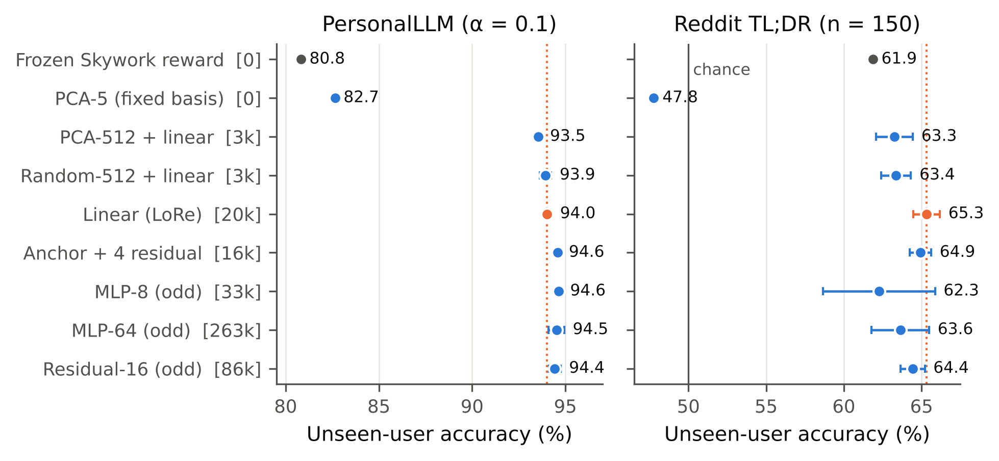
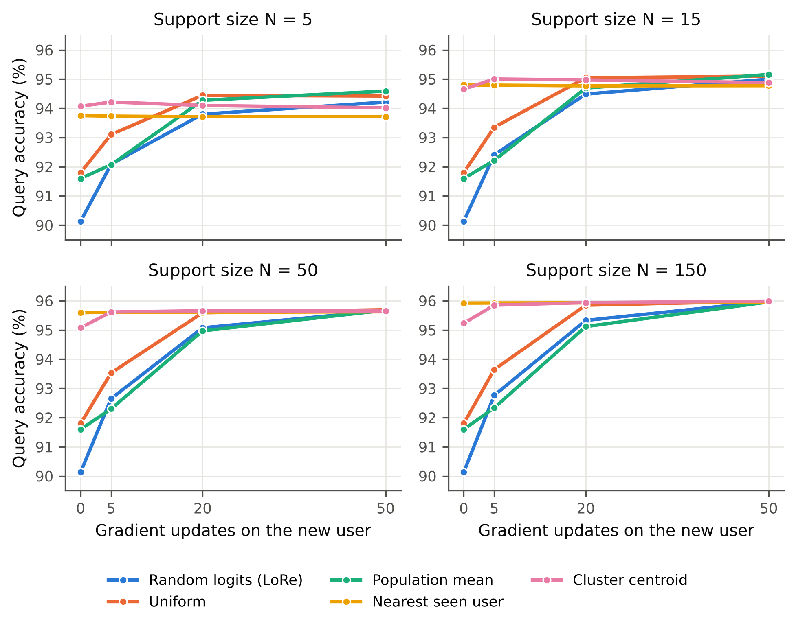

# Where does LoRe's personalisation come from?

**Stress-testing the basis, the function class and the few-shot step of low-rank reward models.**

Course project for **DA5453 – Learning From Human Preference**.
Pratham Kogta (ED22B020) · B S Tejas (ED22B004)

Paper studied: Bose et al., *LoRe: Personalizing LLMs via Low-Rank Reward Modeling*,
[arXiv:2504.14439](https://arxiv.org/abs/2504.14439) (2025).

📄 **Report:** [`report/report.pdf`](report/report.pdf) · 🎞️ **Slides:** [`docs/LoRe_presentation_slides.pdf`](docs/LoRe_presentation_slides.pdf) · 📑 **Paper:** [`docs/LoRe_paper_arXiv2504.14439.pdf`](docs/LoRe_paper_arXiv2504.14439.pdf)

---

## The question

LoRe writes every user's reward as a convex combination `w_i^T R_φ` of `K` shared basis rewards. Here `R_φ`
is a single linear map on frozen reward-model embeddings, and a new user is fitted by optimising only
`w_i` on a few comparisons. The paper credits LoRe's simplicity for its success but never ablates its own
design choices. We ask **which component actually carries the personalisation**:

1. the **basis function class / representation** (simpler? richer?),
2. the **simplex constraint** on user weights,
3. the **few-shot step** (random initialisation + Adam).

## Main findings

| | Finding |
|---|---|
| **Exp. 1: Reproduction** | Within 0.4–1.6 pp of the paper on PersonalLLM and 0.8–2.2 pp on Reddit TL;DR. On PersonalLLM, unseen users are *not* more accurate than seen ones. On Reddit, 100→150 seen examples gives no gain. Our frozen Skywork reference on Reddit is much stronger than the paper reports. |
| **Exp. 2: Function class** | The linear basis is essentially sufficient. Odd MLPs add ≤ 0.6 pp on PersonalLLM and lose 1–3 pp on Reddit, where every basis memorises its training set. A *random* 512-d projection matches PCA-512. Anchoring on the pre-trained reward head gives the best seen-user accuracy. |
| **Pitfall 1** | A non-odd network applied to embedding *differences* reaches **100 % accuracy even on pure noise** (orientation shortcut, Prop. 1). Symmetric evaluation (score swapped pairs too) catches it. |
| **Pitfall 2** | A fixed PCA basis with simplex weights scores **47.8 % (below chance)** on Reddit. Simplex weights can't flip a basis direction (Prop. 2). |
| **Exp. 3: Initialisation** | The few-shot problem is convex in `w` (Prop. 3), so initialisation only changes the transient. Picking the best-fitting seen user's weights with **zero gradient steps** matches 50 steps of LoRe's adaptation (within 0.1 pp for N ≥ 50) and beats LoRe's random start by +4.5 to +5.8 pp at 0 updates. |

<p align="center"></p>
<p align="center"></p>

## Repository layout

```
lore/                     Python package (clean re-implementation)
  core.py                 BT loss, joint basis training (Eq. 10), few-shot (Eq. 11), evaluation
  models.py               basis function classes: linear, PCA, projected, odd MLP, residual, fixed anchor
  data.py                 PersonalLLM synthetic users, Reddit TL;DR worker split, pair construction
  projections.py          PCA / random orthogonal projections
  init.py                 initialisation strategies for unseen users
  embeddings.py           frozen Skywork reward-model embedding extraction (GPU)
  synthetic.py            CPU-only planted low-rank benchmark (tests / demo)
scripts/
  extract_embeddings.py   step 0: cache embeddings (GPU, ~2–3 h on an A100)
  run_reproduction.py     Exp. 1
  run_architecture_ablation.py   Exp. 2 (+ --include-naive to show the shortcut)
  run_init_ablation.py    Exp. 3
  make_figures.py         regenerate every figure from results/*.csv (CPU, seconds)
  demo_synthetic.py       CPU demo of the orientation shortcut (~30 s)
results/                  every number in the report, as CSV (see results/README.md)
figures/                  report figures (PDF + PNG)
notebooks/                the original Colab notebooks we ran (with outputs)
report/                   LaTeX source + compiled PDF
docs/                     the paper and our presentation slides
tests/                    pytest suite (CPU, ~15 s)
```

## Quick start

```bash
git clone <this repo> && cd lore-personalization-study
pip install -r requirements.txt

pytest -q                               # 15 tests, CPU
python scripts/demo_synthetic.py        # orientation shortcut on synthetic users
python scripts/make_figures.py          # rebuild all figures from results/
```

### Full pipeline (GPU)

```bash
pip install -r requirements-gpu.txt
python scripts/extract_embeddings.py --dataset personalllm --out data
python scripts/extract_embeddings.py --dataset reddit      --out data
python scripts/extract_embeddings.py --dataset reward-head --out data

python scripts/run_reproduction.py --benchmark personalllm --alphas 0.1 0.001
python scripts/run_reproduction.py --benchmark reddit --n-seen 100 150
python scripts/run_architecture_ablation.py --include-naive
python scripts/run_init_ablation.py --support 5 15 50 150
```

Scripts write `*_rerun.csv` files next to the recorded results so the two can be compared.

## Implementation notes

* **Training recipe** (matches the official LoRe code): `w = softmax(θ)`, `θ₀ ~ N(0, I)`, margin divided by
  `τ = 100`, full-batch Adam (lr 0.5 joint / 0.1 few-shot), loss = Σ over users of the per-user mean
  logistic loss.
* **Odd bases.** Every training row is `e(chosen) − e(rejected)` with label 1, so every basis must satisfy
  `R(−Δ) = −R(Δ)`. Linear maps without bias are odd automatically. Nonlinear ones are antisymmetrised
  as `½(f(Δ) − f(−Δ))`. `lore.core.evaluate_users(..., symmetric=True)` reports swapped-pair accuracy as
  a diagnostic.
* **Embeddings**: final-token last hidden state of `Skywork/Skywork-Reward-Llama-3.1-8B-v0.2`
  (revision `67e958f`), bf16. The reference reward is `score.weight @ e`.

## Citation

```bibtex
@article{bose2025lore,
  title   = {LoRe: Personalizing LLMs via Low-Rank Reward Modeling},
  author  = {Bose, Avinandan and Xiong, Zhihan and Chi, Yuejie and Du, Simon Shaolei and Xiao, Lin and Fazel, Maryam},
  journal = {arXiv preprint arXiv:2504.14439},
  year    = {2025}
}
```

The paper PDF in `docs/` is included for convenience under arXiv's distribution terms. All other
content is released under the MIT License.
